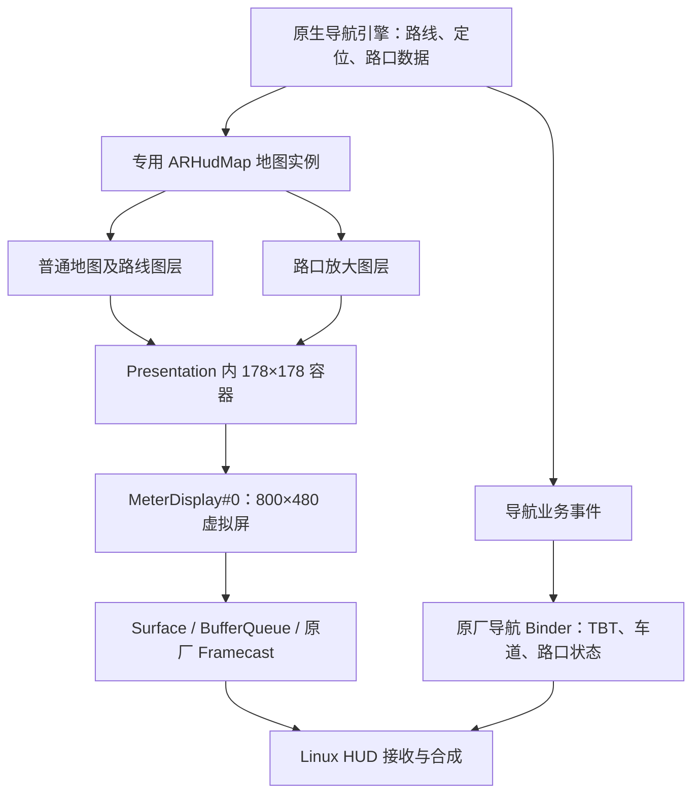

# 原生导航 HUD 右侧 178×178 画面实现分析

日期：2026-10-30。对象：`WT_TinnoveNavigation.apk`，结合此前 `MeterDisplay.apk` 服务分析。范围为当前 J90K 普通 HUD 布局。

## 1. 结论

原生 App 在导航进程内创建专用 HUD 地图实例，将地图 View 放入 `Presentation` 的 178×178 容器，输出到原厂已有的 `MeterDisplay#0` 虚拟屏。该地图同时配置路线图层和路口放大图层：普通导航时绘制精简路线，导航引擎提供路口数据时更新放大图层，并按业务事件控制显隐。

右侧画面的生产依赖导航引擎的地图、路线、定位和路口数据。`sendNavigateCrossRoad(0/1)` 仅发送状态，未通过这个 Binder 方法传送图片。

本轮补齐了引擎路口数据分发、HUD 显隐和底层图层更新的调用证据。**这是静态代码分析；没有连接 ADB、安装应用或新增实车/台架验收结论。**

## 2. 两条输出链路



地图像素和导航结构化信息走各自的链路。左侧 TBT、多车道与右侧地图可以同时出现；不需要把左侧车道行再叠加到右侧。

## 3. 窗口如何创建

### 3.1 查找原厂显示器

`ARHudManager.x()` 先枚举 `DISPLAY_CATEGORY_PRESENTATION`，没有结果时再枚举全部 Display，按显示器名称匹配；默认名称列表含 `MeterDisplay#0`。它没有固定 Android `displayId`。

导航开始由 `N()` 设置导航状态并进入 `U()`，普通 HUD 分支调用 `V()` 创建或显示 `ARHudPresentation`；结束由 `O()`进入隐藏流程。`V()`还检查显示参数变化并处理重新创建。

源码：[ARHudManager.java](../../ApkDecompile/WT_TinnoveNavigation_analysis/hot/sources/com/tinnove/common/ARHudManager.java)，关键位置：313、385、439、459、690 行。

### 3.2 800×480 画布中的 178×178 地图

APK 的 `layout_arhud_presentation` 对应 `res/K98.xml`：

| 项目 | 普通布局值 |
| --- | --- |
| 根布局 | 800×480，透明背景 |
| `map_container` | 178×178 |
| 默认位置 | 距左侧 584，距顶部 179 |
| `map_mask` | 同位置、同尺寸的黑色遮罩 View |
| 单位 | px |

`ARHudPresentation` 继承 `Presentation`。`onCreate()` 加载布局、设置透明窗口背景并取得容器；`b()` 创建或复用地图，调用 `detachFromContainer()` / `attachToContainer(map_container)`。复用时恢复渲染帧率和渲染状态，再设置路线主题并刷新路线。

布局模式还会调整位置：`CLASSES`、`CUSTOM_A`、`CUSTOM_C` 使用右侧，`CUSTOM_B` 移至左侧 x=38，`EASY` 隐藏。不能把默认矩形套用于所有 HUD 模式。

源码：[ARHudPresentation / n8.a](../../ApkDecompile/WT_TinnoveNavigation_analysis/hot/sources/n8/a.java)，关键位置：585 行开始的地图挂载，`onCreate()` / `hide()` / `show()`；[原 APK 布局树](../../ApkDecompile/WT_TinnoveNavigation_analysis/layout_arhud_presentation.tree.txt)；[资源值与布局对应清单](../../ApkDecompile/WT_TinnoveNavigation_analysis/route-map-evidence.json)。

APK 还有 `MapHudType=1` 的另一分支：根布局 2100×680、地图 390×350，不能用于解释当前 178×178 布局。`U()`中的驻车限制也只针对该 type 1 分支，不构成当前台架测试的挡位要求。

## 4. 为什么原生小地图更适合 HUD

创建入口为 `m8.a.a()`，编译源名 `ArhudMapCreator.kt`。它单独创建 `ARHudMap`，业务地图 ID 为 7，宽高直接使用容器尺寸。

| 配置 | 代码行为及作用 |
| --- | --- |
| 地图实例 | 专用 `ARHudMap`，通过 `ng.g.a.e(7)` 查询和复用 |
| 路线与路口 | `drawNavPath=true`、`drawCross=true` |
| 帧率 | normal/nav 配置 10，animation/gesture 配置 24；不是实测跨系统帧率 |
| 车标 | `CarLogo(8,0)`，使用 HUD 缩放配置，关闭车标俯仰 |
| 跟车 | 关联定位服务，锁定地图移动及车标，禁止拖动，锁定 roll/pitch |
| 车标位置参数 | `carUpYRatio=0.8f`；这是引擎配置，实际屏幕位置仍由渲染结果确认 |
| 精简图层 | 关闭 POI、用户、文字标签、鹰眼、组队、选点等图层 |
| 路线 | 单路线，关闭 TMC、普通导航标签及多种辅助路线图层 |
| 路口窗口 | `EnlargedCrossConfig(0,0,width,height)`，可视矩形覆盖完整小地图 |

源码：[ArhudMapCreator / m8.a](../../ApkDecompile/WT_TinnoveNavigation_analysis/hot/sources/m8/a.java:24)；参数顺序核对：[MapConfig.java](../../ApkDecompile/WT_TinnoveNavigation_analysis/decompiled/sources/com/tinnove/wecarnavi/business/api/map/bean/MapConfig.java:31)。

### 4.1 接近路口时自动放大

`ARHudManager.J(GuideInfo)` 根据距下一路口距离更新同一个 HUD 地图：

| 距离 | 普通 HUD zoom |
| --- | --- |
| ≤300m | 19 |
| 301～600m | 18 |
| >600m | 17 |

仅在级别变化时调用 `setZoom(..., true)`。这是普通地图视野的调整，与独立路口图片的出现、消失是两套机制。

### 4.2 专用 HUD 样式

已追踪的高德引擎实现还针对 HUD 选择样式：

- `DeviceIdConverter` 将业务地图 7 转为引擎内部 device 3。
- `RouteLayerStyleAdapter` 根据内部 device 3 选择 HUD 路线样式：路线宽度、边框宽度资源各配置为 10px，另有 `route_arrow_hud`、`arhud_end` 等样式。
- HUD 畅通高亮路线颜色资源为 `#ff00ffa4`。这不表示所有路口图、所有路线分支都使用同一种颜色。
- 路口样式适配器对内部 device 3 使用 `hud_crossing_day_bk_half` 背景标识。
- APK 包含 `assets/blRes/MapAssetHud/` 下的地图样式、图标和 profile 资源；初始化代码复制该目录。资源存在与复制不能单独证明其中每个文件在当前场景都被使用。

因此，原生效果来自单独的视野、图层与样式设计。将手机地图完整缩小到相同像素尺寸，通常不会得到同样的道路粗细、文字密度和构图。

证据：[DeviceIdConverter](../build/hud-native-rightmap-20261030/decompiled/sources/l20/c.java)；[RouteLayerStyleAdapter](../../ApkDecompile/WT_TinnoveNavigation_analysis/decompiled/sources/com/wt/navi/amap/resource/adapter/route/RouteLayerStyleAdapter.java:130)；[HUD 尺寸资源](../../ApkDecompile/WT_TinnoveNavigation_analysis/resources/resources/res/values/dimens.xml:2826)；[路口样式适配器](../build/hud-native-rightmap-20261030/decompiled/sources/com/wt/navi/amap/resource/adapter/enlargecross/EnlargeCrossLayerStyleAdapter.java:30)；[资源初始化](../../ApkDecompile/WT_TinnoveNavigation_analysis/decompiled/sources/com/wt/navi/amap/biz/service/provider/initializer/BaseLibraryInitializer.java:195)。

## 5. 路口放大图如何进入右侧

本轮定位到了不同层的两个同名 `RoadCrossImageManager.kt`，以及实际绘制图层。

### 5.1 引擎收到数据，分发给支持路口图的地图

高德引擎分支 `yr.t.onShowCrossImage(CrossImageInfo)`：

1. 检查该图像类型的支持开关。
2. 从 `crossMap()` 取启用 `drawCross` 的地图。
3. 将 `CrossImageInfo` 交给各地图的 `EnlargedCrossLayer`。
4. 缓存当前路口数据，通知上层业务观察者。

`ARHudMap` 已启用 `drawCross`，所以属于这组地图。新地图加入时，如存在缓存路口数据，还会补发。`onHideCrossImage()` 则隐藏当前图并清除缓存、通知上层。

`drawCross` 的过滤链已逐段核对：`MapConfigConverter` 将该值写入引擎配置的字段；`rs.c.d()` 的过滤函数读取同一字段。联合反编译 `rs.a/b/c` 后确认了 lambda 调用，避免单独反编译造成的方法重命名误读。

证据：[引擎 RoadCrossImageManager / yr.t](../build/hud-native-rightmap-20261030/decompiled/sources/yr/t.java:449)；[配置转换](../build/hud-native-rightmap-20261030/decompiled/sources/l20/f.java:28)；[crossMap 过滤](../build/hud-native-rightmap-20261030/filter-complete/sources/rs/c.java:14)；[引擎配置字段](../build/hud-native-rightmap-20261030/supplement/sources/qs/a.java:130)。

### 5.2 图层按数据类型绘制

`st.a` 编译源名为 `EnlargedCrossLayer.java`，为当前地图取得 `BizRoadCrossControl`。其更新路径如下：

| 引擎 CrossType | 更新路径 | 输入 |
| --- | --- | --- |
| 1，栅格 | `updateRasterImage()` → `setRasterImageData()` | 道路图与引导箭头两份缓冲 |
| 3，矢量 | `updateCross(...,3)`，成功后设置 `CrossImageInfo` | 矢量数据和路口信息 |
| 4，3D | `update3DImage()` → `updateCross(...,4)` | 3D 路口数据 |

栅格路径创建两份 `LayerTexture`；矢量/栅格样式使用传入的显示矩形。HUD 创建阶段已将放大图配置和可视矩形设为完整的 178×178。

这些数据不应一律视为可直接解码的 PNG/JPEG；矢量和 3D 数据依赖配套引擎解析。Java 代码证明存在对应绘制路径，不能代替当前布局中每种类型的实图验收。

证据：[实际放大图层 / st.a](../build/hud-native-rightmap-20261030/decompiled/sources/st/a.java:173)，栅格纹理在 305 行起；[业务图层包装](../build/hud-native-rightmap-20261030/decompiled/sources/q10/a.java)。

### 5.3 业务层控制主地图和 HUD 的显隐

`pf.c` 也是 `RoadCrossImageManager.kt`，实现 `IRouteGuideInfoObserver`：

- `onCrossImageNeedShow()` 缓存 `GuideCrossData`；允许显示时，同时开启主地图及业务地图 7 的放大图层。
- 关闭放大图显示，或地图界面相关动画运行时，隐藏这两个图层。
- `onCrossImageNeedHide()` 清数据并隐藏两个图层。
- `RouteGuideViewModel.T4()` 将此观察者订阅到 `IGuideSubscriber`，`a6()` 解除订阅；不是只定义而未使用的回调。

动画判断 `mb.k.h0()` 已核对为 `ValueAnimator.isRunning()`，不能将其解释成挡位或驾驶状态条件。引擎层另有自动控制模式，业务层也能覆盖显隐；真正显示仍受当前图像、配置、导航窗口和输出链路共同影响。

证据：[业务 RoadCrossImageManager / pf.c](../build/hud-native-rightmap-20261030/decompiled/sources/pf/c.java:76)；[实际订阅](../../ApkDecompile/WT_TinnoveNavigation_analysis/decompiled/sources/com/tinnove/wecarnavi/guide/vm/RouteGuideViewModel.java:3584)；[动画条件](../build/hud-native-rightmap-20261030/supplement/sources/mb/k.java:820)。

### 5.4 “实景图”目前能确认到哪里

业务枚举包含 `RASTER=10000`、`VECTOR=10001`、`_3D=10002`、`REAL_PIC=10003`。这些编号与引擎的 1/3/4 不是同一套编号。

本轮确认的是栅格、矢量和 3D 分支。**仅凭 `REAL_PIC` 枚举，不能确认本版向当前 HUD 布局提供摄影式实景图片，也不能确认 iPhone 高德的路口图会进入 CarPlay 辅助视频。** 原生引擎有路口图能力，与手机是否输出对应内容是两个需分别验证的问题。

## 6. Binder 与跨系统画面服务的边界

### 6.1 路口 Binder 只传状态

`DoubleNavigateImpl` 的 `onCrossImageNeedShow(data)` 调用 `onCrossRoad(1)`，隐藏调用 `onCrossRoad(0)`，最后执行 `sendNavigateCrossRoad(int)`。没有把 `dataBuffer` 或 `arrowDataBuffer` 交给该方法。

上层 `bd.a` 还会把业务类型 `10002` 的路口通知转换为隐藏状态；这只能说明该 Binder 状态分支的处理，不能反推引擎内部完全不绘制 3D。

证据：[DoubleNavigateImpl](../../ApkDecompile/WT_TinnoveNavigation_analysis/hot/sources/com/tinnove/dashboard/DoubleNavigateImpl.java:327)；[类型分支](../../ApkDecompile/WT_TinnoveNavigation_analysis/hot/sources/bd/a.java:289)。

### 6.2 MeterDisplay 负责完整显示屏帧

原生导航使用已有 Display。负责创建它的是 `MeterDisplayService`：

```text
Native.createSurface(name,width,height)
  → DisplayManager.createVirtualDisplay(...,surface,...)
  → Native.bindDisplayToSurface(dynamicDisplayId,surface)
```

178×178 的布局由导航 App 决定，MeterDisplay 服务承载的是完整虚拟屏。此前该服务的 Native 分析恢复了 `BufferQueue → GraphicBuffer/Fence → MeterShowManager → libframecast` 路径，传递帧描述并依赖厂商缓冲机制。不能把该通道视为可以直接发送任意 PNG 或 H.264 的通用端口。

业务地图 ID 7、引擎内部 device 3、Android 动态 Display ID、Linux screen 编号各自独立。

证据：[服务创建显示器](../../ApkDecompile/MeterDisplay_analysis/decoded/sources/com/raite/meterdisplay/server/MeterDisplayService.java:430)；[已有服务及 Native 分析](../../ApkDecompile/MeterDisplay_analysis/README.md)。本轮没有重新分析 Linux 接收端，也未用服务的固定内容检测返回值作为出图证据。

## 7. 对 DiPlay 的直接影响

| 环节 | 原生导航 | 当前 DiPlay |
| --- | --- | --- |
| HUD 输出 | Presentation → MeterDisplay → HUD | 已使用同类窗口及 178×178 输出接口 |
| 普通地图输入 | 进程内地图引擎、真实路线及定位 | 生产链路使用手机 type 111 辅助视频 |
| HUD 样式 | 独立地图配置、专用路宽/图标、距离缩放 | 手机决定视频中的地图样式，接收端不能直接修改其中的路线图层 |
| 路口图 | 引擎回调给出数据并有显隐事件 | 尚未确认高德真实路口图进入辅助流，尚无已确认独立图片入口 |
| 本地矢量绘制 | 引擎提供完整路线及路网 | 已有离线 RouteScene 绘制基础；实时 CarPlay 尚未提供已验证的路线几何输入 |
| 左侧车道 | 结构化导航数据通路 | 继续由原厂 Binder 车道行承载 |

当前实现证据：[MzdHudMapOutput](../vehicle-mzd/src/main/java/com/shilapi/vehicle/mzd/MzdHudMapOutput.kt:31)；[真实路口图接入与验证准备](HUD_CARPLAY_JUNCTION_IMAGE_20261029.zh-CN.md)；[离线矢量路线实现及边界](HUD_VECTOR_ROUTE_IMPLEMENTATION_20261030.zh-CN.md)。

开发顺序据此可确定为：

1. 保留现有 OEM 窗口、导航门控与清屏实现，继续核验手机辅助流是否携带所需路口图。
2. 若手机已合成路口图与地图切换，直接呈现并验证其生命周期。
3. 若取得独立图像与出现/消失事件，在来源适配层接入，经中立像素契约送到 OEM 输出；OEM 不解析高德或 CarPlay 私有字段。
4. 若需本地重绘类似原生的简图，先取得与手机当前选中路线一致的真实几何、定位及航向，再使用已有路线绘制层。转向和车道角度不足以还原真实道路。

`IEnlargedCrossLayer` 是原生 App 内部地图对象接口。当前证据没有把它识别为能由 DiPlay 跨进程注入 iPhone 路线或索取路口图片的系统 Binder 服务。仅调用路口状态 Binder 不能补出缺失的地图或图片。

## 8. 分析身份与验证记录

- APK：`C:/WorkSpace/CodeSpace/ApkDecompile/WT_TinnoveNavigation.apk`。
- 大小：376,429,989 字节。
- 本轮重新核对 SHA-256：`4f5519d097f1bc4614a6b1943a6e97484fb67e772e3c1387579b76b70d28b81e`，与已有资源分析一致。
- 新增定向反编译与证据位于 `build/hud-native-rightmap-20261030/`；[证据散列清单](../build/hud-native-rightmap-20261030/evidence-manifest.json)记录来源文件与关键行。
- 反编译仅对 APK 副本做静态处理，没有修改或执行附件 APK。混淆类以编译源名、调用关系、参数与资源交叉核对；候选 DEX 扫描结果不单独作为结论。
- 本轮新增分析报告及 ignored build 目录的研究产物，未修改应用实现，未运行 Gradle CI，也没有用历史 CI 或截图代替本轮设备验证。
