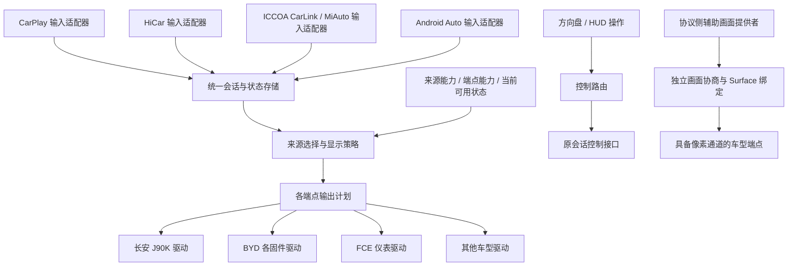

# DiPlay 多协议 HUD / 仪表接入架构

状态：目标架构与分期计划；首期公共契约、CarPlay 结构化接缝和 `vehicle-mzd` 驱动已开始实施，真实手机/台架验收待完成。更新：2026-10-28。阅读基线：`d998b18c`。当前代码范围见 [首期实现记录](VEHICLE_DISPLAY_MZD_IMPLEMENTATION.zh-CN.md)。

目标：让 CarPlay、HiCar、ICCOA CarLink、Android Auto 通过统一数据契约接入 HUD / 仪表，并让新的车型、固件及传输方式可以独立扩展。用户已明确 Carlink 指 MiAuto 仓库使用的 **ICCOA CarLink**。以下统一使用这个名称，将其列为有现有 SDK 入口可对接的输入来源，适配器尚未实现。

评估结论：**长期分层方向符合协议与 OEM 分离原则；原先把 API/core、存量 BYD/FCE、媒体订阅和会话所有权迁移列为 J90K 前置步骤，首期改动偏大。** 本文第 4～11 节描述目标能力与约束，第 12 节收敛后的首期范围具有实施优先级：先增加小型契约、CarPlay 数据接缝和独立车型驱动，存量迁移后置。按用户要求，车型模块名为 `vehicle-mzd`，内部仍保留本次台架对应的 J90K 固件差异；不将它推广为所有 Mazda 固件的通用接口。

## 1. 建议采用的结构

**采用“输入适配器 → 统一状态与调度 → 车型显示驱动”，分别定义结构化信息、画面和反向控制三条通道。**

新接一种手机协议，应主要新增输入适配器；新接一个 HUD / 仪表，应主要新增车型驱动与能力配置。两端不互相引用。真正需要新增领域能力时，先扩展统一契约，再分别补充支持它的输入和输出。



三条通道共用会话身份及资源所有权，但承载的内容不同：

| 通道 | 内容 | 边界 |
| --- | --- | --- |
| 结构化状态 | 导航、音乐、电话、连接与可用性 | 不包含 iAP2 帧、厂商 Binder 号、Bitmap、Surface |
| 画面 | 辅助地图、图像流、自绘卡片 | 独立协商格式、尺寸、裁剪、Surface 生命周期；大帧不走状态分发队列 |
| 反向控制 | 播放/暂停、切歌、接听/挂断、内容切换 | 回到数据所属的活动会话；独立检查控制能力及命令结果 |

## 2. 当前代码的实际结构

### 2.1 Gradle 模块

`settings.gradle.kts` 中：`:mobile`、`:automotive`、`:mazda` 为应用，`:common` 是共享宿主界面与集成层，`:shared` 是 Android library，包含 CarPlay 协议、媒体、连接编排及多种车型代码。`:home`、`:maphost` 分别位于 `samples/home`、`samples/maphost`。

`:common` 通过 `api(project(":shared"))` 依赖 `:shared`。目前不是“纯协议库 + 独立车型库”的物理隔离。

`automotive` 是 Android Automotive OS 应用目标，不代表已经实现 Android Auto 手机投屏协议。DiPlay 内当前未发现完整的 HiCar、ICCOA CarLink、Android Auto 接收实现。相邻 MiAuto 仓库已有 ICCOA CarLink SDK 集成，下面单列其真实接缝；HiCar / Android Auto 的未来接入取决于各自实现和回调。

### 2.2 关键链路及耦合位置

| 当前代码 | 观察到的职责 | 重构方向 |
| --- | --- | --- |
| [CarPlayController](../shared/src/main/java/com/shilapi/xcertplay/orchestration/CarPlayController.kt) 的 `onRouteFrame()` | 直接调用 `BydNavigationOutputs`、`CarPlayGlance`，再更新 `CarPlayPlaybackStatus`；启动/关闭也直接触及 BYD 输出 | 保留协议/连接编排，向注入的统一输入端口发布数据及会话事件 |
| [BydNavigationOutputs](../shared/src/main/java/com/shilapi/xcertplay/hud/BydNavigationOutputs.kt) | 同时按 iAP2 消息号分发导航、歌曲、电话；管理多个输出工作线程、地图控制、车辆读取入口 | 分拆来源解码、显示调度、车型驱动；车辆到手机的数据另设端口 |
| [BydHudRouteState](../shared/src/main/java/com/shilapi/xcertplay/hud/BydHudRouteState.kt) | 解析 0x5201/0x5202、保留增量缓存和超时，同时提供 Apple 类型及 BYD 映射后的结构 | Apple 增量解析归 CarPlay 输入端；车型图标映射归车型端 |
| [BydHudBridge](../shared/src/main/java/com/shilapi/xcertplay/hud/BydHudBridge.kt)、[BydClusterBridge](../shared/src/main/java/com/shilapi/xcertplay/hud/BydClusterBridge.kt)、[FceClusterBridge](../shared/src/main/java/com/shilapi/xcertplay/hud/FceClusterBridge.kt) | 每个桥仍接收原始 `Iap2Frame`，各持有导航状态 | 输出只消费统一快照，不重复解析手机协议 |
| [BydClusterSong](../shared/src/main/java/com/shilapi/xcertplay/hud/BydClusterSong.kt) | 同文件内包含 0x5001 解析、歌曲选择、定时策略、ADB 调用和厂商写入 | 拆出音乐状态、显示策略和 BYD 写入器 |
| [CarPlayPlaybackStatus](../shared/src/main/java/com/shilapi/xcertplay/media/CarPlayPlaybackStatus.kt) → [CarPlayMediaKeys](../common/src/main/java/com/shilapi/xcertplay/CarPlayMediaKeys.kt) → [ClusterMusicState](../common/src/main/java/com/shilapi/xcertplay/ClusterMusicState.kt) | 元数据、封面缓存、Android MediaSession 与仪表卡片发布相连；`ClusterMusicState` 暴露 CarPlay 类型与 Bitmap | 元数据、素材存储、Android 媒体系统、显示订阅分别接入统一状态 |
| [BydCarPlayCall](../shared/src/main/java/com/shilapi/xcertplay/hud/BydCarPlayCall.kt) | 同时包含 0x4155 多通电话解析、显示卡片选择、BYD 写入、watcher，并通知 `PhoneAudioRoute` | 电话事实、显示、音频副作用分别订阅；保留原来的清理与所有权机制 |
| [CarPlayGlance](../shared/src/main/java/com/shilapi/xcertplay/glance/CarPlayGlance.kt) | 非车型界面仍复用 `hud` 包中的解析器；另外保存导航和歌曲状态 | 成为统一状态的只读订阅者 |
| [CarPlayHostActivity](../common/src/main/java/com/shilapi/xcertplay/CarPlayHostActivity.kt)、[ClusterMapPresentation](../common/src/main/java/com/shilapi/xcertplay/ClusterMapPresentation.kt) | Activity 负责显示发现、地图 Surface、输出状态与重连；后台会话对象也定义在宿主 Activity 文件中 | 分出会话所有者和显示控制器，UI 只绑定展示与设置 |
| [AndroidMediaSink](../shared/src/main/java/com/shilapi/xcertplay/media/AndroidMediaSink.kt) | 已有主/辅助 Surface 绑定、镜像及解绑机制 | 保留为 CarPlay 画面提供端的实现，外部通过画面端口使用 |

当前已有的 [NavigationOutputWorker](../shared/src/main/java/com/shilapi/xcertplay/hud/NavigationOutputWorker.kt)、电话 watcher、恢复 journal、封面会话校验具有可复用价值。重构应保留这些保证，逐项搬迁其职责。

当前 BYD 输出入口还触及蓝牙挂起、扫描恢复等连接职责。迁移时把它们交给连接集成层，恢复 journal 仍在应用启动时处理，不能因移除 HUD 入口而遗漏恢复。

## 3. 分离原则与依赖规则

1. 手机适配器只理解手机协议及统一契约；车型驱动只理解统一契约及对应原厂服务。
2. 通用模型不使用 `CarPlayNowPlaying`、Apple 转向码、AMap `NEW_ICON`、厂商 `sourceType`、Binder 事务号等作为公共字段。
3. 真实业务状态与显示模式分别建模。CarPlay 无路线可以与某车型保持导航显示模式同时存在。
4. 数据展示、电话音频路由、车控副作用、反向控制分别建模。关闭电话显示不应停止电话状态解析或改变接听能力。
5. 各端点独立工作、独立报告错误；一个 Binder 阻塞不得拖住协议收包、其他仪表或 HUD。
6. 状态按来源会话隔离。旧连接的回调、延迟图片、清理任务不得覆盖或清除新连接的输出。
7. 尺寸、裁剪、编码、图标表、字节限制、焦点规则、保活、固件兼容策略属于车型实现。

依赖规则应由模块依赖及检查脚本约束：输入包不能 import `vehicle.*` / 原厂 SDK；输出包不能 import `iap2.*` / `CarPlayController`；核心不能 import Android / 原厂 SDK；应用装配层可以同时依赖二者。

## 4. 统一数据模型

### 4.1 会话与增量数据

所有更新携带 `SourceSessionKey(sourceInstanceId, epoch)`、本地单调递增 `revision`、本地单调接收时间、领域标识。`epoch` 在会话替换时更换；不直接使用手机号或持久设备标识作为日志中的 key。

手机增量消息先在输入端顺序归并，发布**完整、不可变的领域快照**。必须区分“本条消息未更新”“显式清空”“来源不支持”；不能让省略字段清掉已有值，也不能让明确清空保留旧值。协议补丁中可使用 `Keep / Set / Clear`，快照配合字段状态和来源能力表达未知/缺失。

0x5202 转向缓存、iAP2 artwork transfer ID 等协议状态只保留在 CarPlay 适配器。领域快照中保留语义信息，不要求所有来源模拟 iAP2 的消息顺序。

### 4.2 导航

`NavigationState` 建议包含：

- 路线身份（若来源提供）、阶段 `NONE / GUIDING / REROUTING / ARRIVED / ENDED / UNKNOWN`、结束原因。
- 当前/下一条指引、`ManeuverKind`、方向、行驶侧、环岛出口、到动作距离。
- 独立的指引文字及 `instructionIconRef`，用于 ICCOA 这类提供方向位图而未提供明确转向枚举的来源；语义未知时仍可保留图像能力。
- 当前道路、目标道路、剩余米数、剩余毫秒、到达时间。
- 车道、限速、路口图、路线几何等可选扩展及其来源能力。
- 数据新鲜度、来源状态、可否继续保留旧指引。

基础转向采用通用语义，未知码为 `Unknown`，不得默认直行；扩展字段也不能把不可理解的数据当成确定指引。原始协议码可进入诊断扩展，车型输出不可依赖它才能正确工作。

单位：距离统一米，时长统一毫秒，绝对到达时间使用 Unix epoch 毫秒；新鲜度与通话计时使用单调时钟。各厂商的米/秒、17 位上限、UTC 单位在驱动端转换。

“有导航但当前没有 TBT”“路线结束”“暂时重算”“连接暂断”必须分别处理。来源适配器保留真实语义，端点策略决定显示宽限期；不能为所有端点共用一个隐藏超时。

### 4.3 音乐与歌词

`MediaState` 建议包含：曲目标识及可信程度、确定的歌名、歌手、专辑、素材引用、播放状态、时长、带采样时间的播放位置，以及独立的 `DisplayText / LyricsState`。

歌词支持级别分开：`NONE / CURRENT_LINE / TIMED_LINES`；有当前句不代表有完整 LRC、有下一句或逐字进度。可以携带语言、当前句、可选后续句和时间戳，缺失时保持未知。

**标题中的歌词必须保留语义不确定性。** 当前代码已考虑 `title` 可能逐句变化，但仅凭标题变化无法保证区分换歌与歌词。适配器没有可靠证据时，发布“来源提供的动态文字”，保留其来源标记；不能编造稳定歌名和歌词两份数据。真实曲目标识缺失时，推断结果需要标记可信程度。

手机提供的来源名称与车型 `sourceType` 分离。例如当前 J90K 的原厂 CarPlay 30 不显示，文字兼容27/29无来源图标，35显示原厂在线音乐图标；这些都是固件输出规则，不应出现在通用音乐状态中。当前实现默认27、按OEM构建可选29；文字占位回收依赖独立的Linux布局补丁，见 [SourceType 调整记录](HUD_MUSIC_SOURCE_TYPE_20261028.zh-CN.md)。

### 4.4 电话

`CallState` 保留多通电话列表：会话内 call ID、来/去电方向、号码、联系人显示名、`RINGING / DIALING / CONNECTING / ACTIVE / HELD / DISCONNECTING / ENDED / UNKNOWN`、接通单调时间及支持的操作。

输入端不要预先压扁为“一张正在通话卡片”。端点可根据能力选择来电优先、当前通话、呼叫等待或仅显示号码；接听/挂断操作仍指向准确的来源和电话。

来源仅提供聚合通话状态时，能力中标记其限制。若协议无法指定 call ID，适配器须检查当前目标仍唯一匹配，无法保证时返回不支持，避免操作另一通电话。

### 4.5 素材

核心只传 `AssetRef(sessionKey, assetId, contentRevision, kind)` 与尺寸/MIME 等元数据。Android Bitmap、文件路径、跨进程可读 URI 的生成和回收留在平台层。

素材仓库按会话及曲目代次验证引用，设大小/数量上限；延迟返回的上一首封面不得覆盖当前曲目。引用变化不等于图片已经到达。多个端点共享原始素材，尺寸与编码转换各自缓存。

## 5. 接口契约

以下是职责草图，类型名称与签名用于讨论，不是本轮已实现的 API：

```kotlin
interface ProjectionSourceAdapter {
    val sourceId: SourceId
    fun openSession(publisher: ProjectionPublisher): SourceSession
}

interface SourceSession : AutoCloseable {
    val key: SourceSessionKey
    val capabilities: SourceCapabilities
    val commands: ProjectionCommandPort
    // 各协议的订阅、增量缓存和辅助画面提供者由本会话持有。
}

interface ProjectionPublisher {
    fun publish(snapshot: DomainSnapshot)
    fun lifecycle(event: SourceLifecycleEvent)
}

interface VehicleDisplayDriver {
    fun probe(): TargetDescriptor
    fun openEndpoint(request: EndpointRequest): VehicleDisplayEndpoint
}

interface VehicleDisplayEndpoint : AutoCloseable {
    fun submit(plan: EndpointPlan) // 非阻塞；在所属 worker 应用
    fun clear(request: OwnedClearRequest)
    fun observeStatus(listener: (OutputStatus) -> Unit): Subscription
}

interface ProjectionCommandPort {
    fun submit(command: SessionCommand): CommandSubmission
}
```

`DomainSnapshot` 是导航、音乐、电话等有类型的快照；不使用任意 `Map<String, Any>` 或拼接 JSON 作为通用业务契约。`EndpointPlan` 描述语义槽位和内容，不包含 Binder `Parcel`；原厂 JSON 只在对应驱动内部出现。

来源能力、端点能力与可用状态均可在会话内更新。若某个来源由外部 SDK / 应用提供，可增加实现同一契约的数据桥；此时在桥接边界定义 schema 版本、来源身份、字段单位和生命周期，内部仍使用同一套类型。预留适配器不等于已经取得其他投屏应用的数据访问接口。

`submit()` 的成功只表示入队。后续状态分别表达发送、原厂接受、接收端确认、画面证据；没有后两类证据时保持未知。`clear()` 必须包含 lease / generation，仅清理本会话拥有的输出。

### 5.1 ICCOA CarLink：复用 MiAuto 的实际接缝

本次已读取相邻 `MiAuto` 仓库的 [IccoaManager.java](../../MiAuto/share/src/main/java/com/miauto/app/IccoaManager.java)、[IcocaBridge.kt](../../MiAuto/common/src/main/java/com/andrerinas/openheadunit/connection/IcocaBridge.kt)，并用 `javap` 检查 `share/stubs/icar-sdk-stubs.jar` 的真实类型签名。[SDK 清单](../../MiAuto/share/libs/iccoa-sdk.json)标记 `v1.6.4-202411291742-be8c2ff0`、协议字段 `1.6`；这是该仓库当前集成版本，不代表协议或 SDK 的最新版本。

| 领域 | 现有 ICCOA 接口 | MiAuto 当前消费情况 | 统一层接法 |
| --- | --- | --- | --- |
| 导航 | `onNavigationInfoReceived(phoneId, NavigationInfo)`；`isNavigating`、方向图字节、距离/单位、operation、title1/title2/where | `IccoaManager` 转发 `Listener.onNavigation`，`IcocaBridge` 写入导航 StateFlow；当前 Listener 转发时没有保留 phoneId | 新增 `IccoaProjectionSourceAdapter`，保留 phoneId 与会话代次，生成统一导航快照；方向图进入素材仓库 |
| 音乐 | `onMusicInfoReceived(phoneId, MusicInfo)`；`getTitle/getArtistName/getAlbumName/getCover/getCoverArt/getLyrics/getPlayingCurrentTimeMs/getTotalTimesMs/isPlaying/isDestroyed` | 回调体为空，当前 Listener 没有对应音乐转发 | 扩展输入转发，将确定的歌曲字段、素材、播放位置与歌词分别归一化 |
| 电话 | `onCallInfoReceived(phoneId, CallInfo)`；`getCallState/getName/getNumber/getConnectedTime/getInCallAppId/isIPCall` | 回调体为空，当前 Listener 没有对应电话转发 | 作为电话状态来源；当前已查模型未提供多通电话 UUID 列表，不能宣称完整呼叫等待能力；通话时长单位待确认 |
| 画面 | `IccoaManager.setSurface/clearSurface`、投屏模式及 `onVideoFormat` | 已有本地投屏实现 | 接入独立画面端口；不能将现有主画面绑定能力当成已支持 HUD 辅助地图流 |

音乐模型有独立 `getLyrics()` 是**接口定义层面的确认**，不等于特定手机/音乐 App 一定发送歌词，也不证明该字符串是 LRC、当前句或完整歌词。先保留原始歌词载荷和格式未知状态，取得样本后再选择 `CURRENT_LINE / TIMED_LINES` 等解析方式。

导航的 `getDirectionIcon()` 是 `byte[]`，`getOperation()` 是文本，不能直接当作 CarPlay / AMap 的转向枚举。距离与单位为字符串，按已验证格式转换；解析失败时保持未知，不填零。title1/title2/where 的道路/目的地含义需要样本确认。位图可供像素端点显示，原生 TBT 图标仍需可靠的语义映射。

SDK 的 MusicInfo / CallInfo 有可变 setter。适配器应在回调边界复制标量与有界字节数组，附带 phoneId、会话代次后再异步发布，避免 SDK 复用对象或断线迟到回调污染新状态。

建议连接关系为：

```text
MiAuto IccoaManager / IPhoneDataListener
  → IccoaProjectionSourceAdapter
  → display-api 契约下的会话桥（按需提取 display-core）
  → J90K、BYD、FCE 等相同车型驱动
```

不需要为了 ICCOA 数据先构造 CarPlay 的 `Iap2Frame` 或借用 Android Auto protobuf。MiAuto 保留 SDK 生命周期、init-once、模式协商和手机连接实现；显示侧消费统一契约。

跨仓库复用时，先将 `display-api` 与所需车型驱动作为独立、有版本的库，由 DiPlay 与 MiAuto 分别依赖；实际需要多来源/多端点调度后再共享 `display-core`。不要让 MiAuto 依赖 DiPlay 整个 `common` UI 模块，或让 DiPlay 依赖 MiAuto 整个宿主。`IccoaManager` 中的手机数据入口可转接适配器，`IcocaBridge` 继续作为 MiAuto 的 UI 消费者。

ICCOA 建议作为 CarPlay 之后首个实际的第二来源：同一套合成领域快照与车型输出用例分别由两种输入适配器驱动，验证输出端没有继续依赖 Apple 数据。手机数据是否到达、HUD 是否出图仍分别验收。

## 6. 核心服务职责

以下为长期职责划分，并不要求首期为每一行创建类或模块。首期只有单一活动来源和单个 J90K 设备时，采用显式注入的会话桥及有界串行 worker；会话代次、字段清空、失焦和退出清理仍必须落实。出现实际的多来源/多端点需求后再提取公共调度组件。

| 组件 | 职责 |
| --- | --- |
| `ProjectionSessionRegistry` | 登记协议会话、代次、活动状态和控制端口 |
| `ProjectionStateStore` | 按来源会话保存完整快照，提供多订阅，重放当前值 |
| `SourceSelectionPolicy` | 为输出选择数据所属来源，防止多个手机状态意外混合 |
| `VehicleDisplayRegistry` | 注册驱动工厂，识别端点，管理显示器增删和能力变化 |
| `DisplayPolicyEngine` | 根据端点槽位、能力、设置和当前状态生成输出计划 |
| `EndpointCoordinator` | 每台物理设备协调资源冲突、lease、焦点礼让、绑定及清理 |
| `CommandRouter` | 检查来源/电话/曲目代次及控制能力，再发送到原会话 |
| `AssetRepository` | 有界素材存储与引用管理，平台实现负责解码 |
| `OutputDiagnostics` | 关联来源 revision、计划、传输结果和测试证据 |

注册表先采用编译时注入工厂，后续再按需要扩展。没有必要为了模块分离引入动态下载插件、进程间总线或统一网络协议。

状态订阅支持多个消费者。Android MediaSession、Home 小组件、仪表卡片和 HUD 分别订阅；不再各占用 Controller 上唯一的 listener。实现可使用有类型回调与串行执行器，协程/Flow 的选择不应改变契约。

## 7. 来源选择、线程与生命周期

### 来源选择

初始版本按“当前活动投屏会话”统一选择导航、音乐和电话来源。若未来允许跨来源组合，应显式配置领域路由及来源标识；不能仅按最后到达的一条消息切换来源。

有多个候选会话时由确定的选择策略决策；切换先撤销旧资源所有权，再激活新计划。端点恢复连接时应用当前快照，不能重放整段历史消息。

### 顺序与队列

- 原始协议增量按会话顺序解析；不能在 0x5201/0x5202 完成归并前只保留“最后一帧”。
- 归并后的完整状态可按会话/领域合并最新值，避免距离和播放进度更新堆积。
- 会话开始/结束、显式清空、所有权转移等控制事件走有界可靠队列，不能被普通状态覆盖。终止代次形成屏障，拒绝其后到达的旧更新。
- 每端点一个串行调度所有者；同一设备共享焦点/传输资源时由设备协调器串行处理相关事务。
- 超时及重试有界。同步 Binder 卡住时先隔离该端点；不能假设打断线程能取消 Binder 调用。租约代次在调用返回后再次检查。

### 生命周期

长期建议从当前 `CarPlayBackgroundSession` 逐步抽出应用范围的 `ProjectionRuntime`，由前台会话服务承载持续会话。Activity 绑定 UI / Surface，不作为唯一的数据和输出所有者。该迁移涉及后台连接与 UI 重建，后置为独立重构。首期将新的数据接缝绑定现有 Controller 的会话开始、暂断、替换及关闭事件；同一 Controller 在后台存活时继续拥有接缝，避免跟随 Activity 的单次销毁释放。现有显式断开、任务移除和重连清理语义在迁移时保持。

明确区分 `ExplicitDisconnect / TemporaryTransportLoss / SessionReplaced / RouteEnded / AppStopping / EndpointLost`。暂断保留必须由来源关联同一逻辑会话并有有限期限；新手机不能继承旧手机的路线、歌词或电话。路线到达/取消不能被“暂断保留”覆盖。

进程死亡没有可靠的 Java `finally` 回调。需要设备恢复的端点继续使用 owned journal、watcher 或原厂死亡回调；未归还的资源在下次启动按原租约恢复。不要让旧 journal 恢复任务清掉新输出。

## 8. 画面通道单独设计

导航状态不等于有可用地图视频。来源可能只有 TBT、可能有路口图片，也可能有辅助画面；目标也可能只接受原生图标。

建议画面协商顺序：

1. 目标报告像素区域、分辨率、安全区、允许的画面形式和当前可用条件。
2. `FrameRouteBroker` 计算来源与目标能力交集，向来源请求地图内容或创建本地卡片渲染器。
3. Android 平台层提供 `SurfaceLease`，CarPlay 适配器内部再映射 stream 111、URL 和已有 `AndroidMediaSink` API。
4. 目标模式/显示器/来源发生变化时按代次解绑，确认解码器不再使用旧 Surface 后释放。
5. 多端点共享画面时显式协商镜像/重采样能力与资源预算，不能把一个 Surface 当作可任意广播的帧对象。

核心看到的是 `AuxiliaryContentKind.MAP / INSTRUCTION_CARD / CUSTOM_CARD` 等语义。Apple 的 `maps:/...` URL、流编号以及厂商 Framecast 物理缓冲区格式留在各自适配器。

封面等静态素材通过素材仓库，地图视频通过画面路径；不能把高频 Bitmap / H.264 字节塞进通用状态队列，也不能将 Framecast 8128 当作普通 H.264 上传接口。

## 9. 车型、端点与能力

### 9.1 一辆车不只一个输出端点

`TargetDevice` 下可以同时有 `WINDSHIELD_HUD`、`INSTRUMENT_CLUSTER` 和可绘制区域。导航/媒体/电话的结构化服务与像素通道可以由不同实现组成，但同一设备的焦点和资源由一个协调器管理。

`NativeWidgetEndpoint` 负责把统一模型映射成原厂控件；`PixelViewportEndpoint` 负责显示本地渲染或来源画面。原生控件不支持的字段，可以在具备条件的像素区域补充；两种输出分别报告能力。

### 9.2 能力至少分三层

| 层 | 示例 |
| --- | --- |
| 来源能力 | 当前句歌词、逐句时间轴、联系人、TBT 车道、辅助地图；以及分别支持哪些控制命令 |
| 目标能力 | 可显示歌名/歌手/封面、电话阶段、环岛出口范围、文字字节上限、像素区域、与导航共存条件 |
| 当前可用状态 | 原厂服务不存在、权限不足、焦点被占用、ADB 断开、显示器未创建、等待导航模式、等待来源素材 |

“可输入此字段”“原厂已接收”“界面已显示”也应分别记录。每项能力附证据级别 `UNKNOWN / CODE_OBSERVED / RECEIVER_CONFIRMED / IMAGE_VERIFIED` 和适用固件，不以一个 `supportsHud=true` 覆盖全部能力。

最终输出由来源数据、来源能力、目标能力、设置及当前可用状态共同决定；缺失字段保留未知，按预定规则降级。没有歌词时显示已知歌名；没有可用画面时继续已支持的结构化导航，不自动宣称地图可用。

驱动探测优先读取服务、描述符、固件与权限。对未知设备不靠发送导航/电话/车控写入来尝试识别。生产端不把 shell UID 下的验证结果直接当作普通应用权限通过。

## 10. 长安 J90K 的具体接入位置

新增 `ChanganJ90kDriver`，设备内部由下列子组件组成：

| 子组件 | 职责 |
| --- | --- |
| `J90kInteractiveClient` | 共用服务发现、Binder 连接、死亡重连；保存真实调用权限状态 |
| `J90kNavigationWriter` | 导航焦点、状态/转向/剩余信息及图标映射 |
| `J90kMediaWriter` | 媒体焦点、来源兼容值、原生文字/歌词与封面事务 |
| `J90kPhoneWriter` | 电话业务接口、秒单位和字节长度转换；以现有探针恢复的实际接口为准 |
| `J90kViewportController` | 动态发现既有 MeterDisplay、绑定 Presentation / Surface、裁剪和模式依赖 |
| `J90kDeviceCoordinator` | 协调原生导航、电话/音乐及右侧画面之间的焦点和模式 lease |
| `J90kFirmwareProfile` | 针对实际固件保存能力、映射、显示限制及证据 |

导航、音乐可以复用同一个底层 Binder 连接，但独立维护各自焦点、回调及领域状态；电话和像素服务通过各自实际接口接入。**统一接入层并不要求把所有原厂服务改造成同一个 Binder。**

当前台架普通布局中的完整画布为 800×480，右侧实测 178×178，矩形 `[584,179,762,357)`。这些值放在 J90K 布局配置中；运行时仍验证显示器与尺寸，不全局硬编码 displayId 或所谓通用 170×170。

原生音乐目前确认的是兼容来源下单行文字；独立歌名/歌手、多行歌词、原生封面不能标为显示通过。像素通道能绘制卡片也不等于真实 CarPlay 封面/歌词输入已通过。原生电话展示与接听/挂断控制分别验收。

### 无实际导航时的扩展卡片

这是 J90K 驱动的实验能力：

```text
真实 NavigationState = NONE
端点希望显示 MusicCard
J90kDeviceCoordinator 申请 AuxiliaryModeLease
J90kNavigationWriter 按固件要求维持物理导航显示模式
J90kViewportController 显示卡片
```

统一状态仍为无路线；不要向其他端点、Home 或手机广播一条虚假路线。物理导航模式、TBT 清空及左侧残留处理属于该固件配置。

现有测试已证明导航模式下右侧可显示自绘内容，但正对照带合成 TBT。“仅保留导航状态、无左侧导航字段、可长期常驻”尚未通过。该配置保持待验证/实验状态；原厂导航取焦、真实导航到来、断开或退出时，协调器转换或释放 lease。

## 11. 显示仲裁按资源进行

不要用全局“电话 > 导航 > 音乐”强制关闭整台设备。先声明哪些槽位共用资源：原生电话覆盖层、TBT 区、歌词行、右侧像素区域等。

- 共用一行时导航指引优先于音乐文字；未共用的区域可以继续显示。
- 来电占用原厂覆盖层时，记录被遮挡状态；不必清空仍有效的路线数据。
- 右侧显示真实地图时，音乐卡片遵循该端点的替换策略；来源没有地图流时可按配置显示其他已支持内容。
- 原厂焦点、用户设置和固件约束优先于刷新频率。失焦不通过循环抢焦点恢复。

设备协调器还需声明互斥传输、最大更新速率、心跳和依赖关系。核心给出内容意图，驱动决定合法的原厂调用次序。

## 12. 模块落地与迁移

### 12.1 对原方案的评估

| 评估项 | 原方案的影响 | 收敛后的要求 |
| --- | --- | --- |
| 最小功能改动 | J90K 前先迁移 BYD/FCE、媒体系统及会话所有权，跨越连接、音频、UI 和多个应用 | J90K 先接新增路径；旧消费者的迁移按实际收益单独立项 |
| 协议与车型分离 | 统一模型方向正确，但把新车型放在 `shared/vehicle` 仅有包边界 | 新增 J90K 驱动从首期即为独立 Android library，只依赖小型契约及必要平台 API |
| 运行时隔离 | 设备探测与配置可以限制启用，但仍可能在所有应用初始化 | 应用显式装配目标驱动；端点获得资源前检查服务、权限及配置 |
| 构建与打包隔离 | `common → shared` 使其中车型类、原厂依赖及 Manifest 可能进入所有应用 | 具体应用或变体直接依赖所需驱动；`common/shared` 不依赖 J90K 模块 |
| 跨协议复用 | 完整 core 作为第一步会提前引入注册表、策略引擎与路由体系 | 先复用契约和驱动；第二来源实际接入后据共同需求提取 core |
| 既有 OEM 技术债 | BYD/FCE 已耦合在 shared，新增架构无法立即改变历史事实 | 明确首期只保证新增路径的分离；全仓 OEM 物理隔离需后续迁移 |

“最小改动”应同时考虑回归面与依赖边界。为减少模块数，把新 OEM 服务、权限和映射继续放入 `shared`，会扩大后续车型接入的影响。首期新增两个有实际职责的模块是合理成本；完整通用调度框架可以后置。

### 12.2 首期最小依赖边界

建议首期新增：

- `:display-api`：小型纯 Kotlin/JVM 契约。先覆盖导航、音乐、电话的必要语义、会话代次、来源/端点能力、发布/清理端口及素材引用；按实际用例增加字段。第 4～11 节的完整类型、命令体系与调度组件按需实现。
- `:vehicle-mzd`：独立 Android library。包含原厂接口、连接/死亡处理、固件映射、焦点、刷新/清空顺序及工作队列。原厂 `sourceType`、Binder 事务、178×178 与导航模式依赖全部留在模块内。

CarPlay 输入适配器首期放在 `:shared/projection/carplay`，复用现有协议栈；该路径输出统一快照。原始帧、Apple 类型及封面 transfer ID 止于输入适配器。车型模块不依赖 `:shared`，避免间接拉入整个 CarPlay/音频栈及历史 BYD 实现。

```text
common ─────────────> shared 中的 CarPlay 输入适配器 ──> display-api
  └────────────────────────────────────────────────> display-api

选定的应用 / 变体
  ├─ common（通用宿主及装配端口）
  └─ vehicle-mzd ──────────────────────────────────> display-api

运行时：应用提供驱动工厂 → common 为当前 Controller 建立数据桥
        CarPlay 适配器 → 统一快照 → 会话桥 → J90K 端点
```

`common` 只定义/使用通用装配端口，具体应用通过 Application 提供者等显式工厂注入 J90K。无需反射类名、动态插件或全局服务定位器。默认工厂为空实现；新增可选参数应提供默认值，使原有宿主和测试继续采用原路径。应用的依赖图决定打包哪些 OEM 驱动，运行时工厂决定启用哪个驱动。

如果产品要求单个通用 APK 支持多车型，该 APK 会主动包含多个驱动；此时可以保证模块职责分离与运行时选择，不能声称没有打包其他 OEM 代码。单车型包通过应用/变体选择依赖实现物理排除，依靠关闭开关或 R8 不能作为隔离保证。

首期会话桥针对一个活动投屏来源与一个 J90K 设备，串行发送完整领域快照。它负责有限的会话校验和路由，驱动负责设备资源协调；实现无需提前引入 `display-core`、通用 Registry、策略 DSL 或新的后台服务。后续同时支持多个来源或端点时，再将共有职责提取为 core。

### 12.3 对现有仓库的具体影响

以下为预计改动位置，属于范围评估，不是已经完成的变更清单或精确文件数量承诺。

| 位置 | 首期所需改动 | 回归关注点 |
| --- | --- | --- |
| `settings.gradle.kts`、新增模块构建文件、CI | 注册 API 与 J90K 模块，增加对应测试/lint/build 任务 | JVM/Android 插件兼容性；各应用依赖图与合并 Manifest |
| `CarPlayController.kt` | 增加默认空实现的输入观察接缝；转发导航/电话原始事件、已归并媒体更新、素材事件及会话生命周期 | 保持数据顺序；接缝非阻塞且异常不外溢；初始化、断线重连、close 的代次一致 |
| `shared/projection/carplay` 新文件 | 将 iAP2 输入转为通用快照，保留增量/清空语义、曲目与素材归属 | 只在此处解释 Apple 语义；禁止重复请求音乐元数据；延迟封面不能串曲目 |
| 现有解析器 | 必要时仅提取新的适配器与旧消费者共同使用的纯解析部分，提供兼容 facade | `BydHudRouteState` 的协议缓存、BYD 映射和显示超时混合，不能整个搬成通用模型；新端点策略独立 |
| `CarPlayHostActivity.kt` / 通用装配端口 | 在现有 Controller 创建点注入会话桥；清理依附 Controller 所有权 | UI 重建/后台继续使用原会话，旧 Controller 的关闭不能清新会话 |
| 选定应用的 Gradle、Application / Manifest | 声明 J90K 依赖并提供工厂；原厂 queries、权限及组件限定在目标依赖范围 | Mazda、AAOS 等未选择 J90K 的应用不出现该模块的类、依赖与新增 Manifest 项 |
| J90K 驱动新文件 | 移植 HUDDemo 的已验证原厂接口与映射，适配统一快照 | 普通应用 UID、焦点、Binder 死亡、资源恢复与截图验证 |
| BYD/FCE 输出、`CarPlayMediaKeys`、Glance、`ClusterMusicState` | 全量迁移后置；现有消费者继续使用原发布方式 | 新增路径不得占用现有三个唯一 listener；不得触发另一套音频路由或抢同一硬件 writer |
| `CarPlayBackgroundSession`、`DiPlaySessionService`、`AndroidMediaSink`、地图 Presentation | 所有权重构和通用 Surface 抽取后置到独立里程碑 | 首期结构化 HUD 接入不以这些迁移为前置条件 |
| Settings 与多语言资源 | 出现正式用户开关时单独纳入；首个台架接缝可使用目标应用显式配置 | 用户可见开关按 AGENTS.md 的类别、实验标记、翻译与 UI 验证要求实施 |

Controller 的 `playbackListener/nowPlayingListener/artworkListener` 目前由 `CarPlayMediaKeys.attach()` 设置并在 detach 时清除。新增 HUD 订阅应采用独立、受会话所有权管理的观察入口，或在既有解析后增加旁路发布；直接替换这些 listener 会影响 Android MediaSession 与已有音乐显示。

新适配器首期可以与旧消费者并行读取同一会话，以避免一次迁移所有 BYD/FCE 消费者。复用解析逻辑并不要求立即统一它们的状态实例；新路径自身必须正确归并。后续确认等价后再逐端点切换，并约束同一硬件只有一个 writer。旧 `BydNavigationOutputs` 中蓝牙/扫描恢复、车辆数据与音频副作用仍属于独立迁移事项。

### 12.4 收敛后的实施顺序与验收

| 阶段 | 工作 | 完成标准 |
| --- | --- | --- |
| M0：契约与接缝 | API、小型会话桥、CarPlay 新适配器；以记录端点观察快照 | 增量保留/清空、素材归属、会话替换正确；记录端点无硬件写入，既有消费者回归通过 |
| M1：J90K 结构化信息 | 目标应用装配独立驱动，逐项接导航、音乐、电话 | 普通应用权限下分别取得发送/接收/截图证据；结束恢复基线；未选择 J90K 的应用无该依赖；原厂业务副作用可控 |
| M2：第二来源验证 | MiAuto 单独依赖契约和同一 J90K 库，扩展 ICCOA 回调转发 | ICCOA 保留 phoneId/代次；输出驱动无 Apple 类型依赖；音乐/电话及歌词实际可用性分层验收 |
| M3：独立画面里程碑 | 增加实际需要的画面端口，接 J90K 地图/卡片；按需提取 Android 工具 | 通过 Surface/画面退出与失焦清理；无导航常驻依然按实验项验证；不以通用框架抽取代替实际出图 |
| M4：有收益时迁移存量 | 逐端点迁移 BYD/FCE；根据复用需求抽取 core、MediaSession/Glance 订阅及应用 Runtime | 每次只切一个端点/消费者；旧恢复、音频、后台及控制语义有对应验证 |
| 后续来源 | 接入具备真实 SDK/回调的 HiCar、Android Auto | 适配器消费真实数据并声明缺失能力；避免预先制造空实现模块 |

M1 的逐项功能可独立验收，某个领域或固件能力未通过时明确降级。M2 和 M3 可按产品优先级调整，不依赖 M4 的全仓迁移。

验证分三层：源码 import/模块依赖检查保证职责；运行时配置及探测保证启用范围；Gradle 依赖、合并 Manifest 和 APK 检查保证打包范围。未选车型的应用也要参与 CI，防止公共模块引入 OEM 依赖。测试覆盖新边界的会话替换、断开清理、慢/失败端点隔离及必要的解析差异，避免为文档类型逐字段生成测试。

### 12.5 后续存量迁移清单

以下属于 M4 及之后的目标，首个 J90K 功能交付无需完成整表。

| 现有对象 | 目标职责 |
| --- | --- |
| `BydHudRouteState` | CarPlay 输入端的增量导航 reducer；BYD 映射拆到 BYD 驱动 |
| `ClusterSongState`、`CarPlayPlaybackStatus` | 统一到 CarPlay 媒体 reducer，输出不同订阅者需要的快照 |
| `CarPlayCallState` | CarPlay 电话 reducer；名称字节截断从这里移到 BYD 驱动 |
| `BydNavigationOutputs` | 逐步由 Runtime + Registry + 独立驱动替代 |
| `BydClusterSongTool`、`BydCarPlayCallTool` | 保留为 BYD 平台写入实现，不接受手机协议数据 |
| `CarPlayGlance`、`ClusterMusicState` | 订阅通用快照，保留旧界面的薄兼容 facade 直到迁完 |
| `CarPlayMediaKeys` | Android MediaSession / 按键 / 音频焦点消费者；不作为 HUD 元数据唯一来源 |
| `CarPlayCallKeys` | 车型输入识别与 `CommandRouter` 调用；不从 BYD 显示卡片取电话事实 |
| `ClusterMapPresentation`、`AdbClusterRouter` | Android 画面实现和车型显示发现，交给显示控制器持有 |
| `PhoneAudioRoute`、车辆数据到 iPhone | 分别保持独立音频与 `VehicleSignalProvider` 端口，避免绑定到 HUD 生命周期 |

## 13. 验证与诊断设计

测试应覆盖边界和真实差异，避免为每一个字段写只镜像实现的测试：

| 测试层 | 重点 |
| --- | --- |
| 输入契约 | iAP2 增量保留/显式清空、0x5202 缓存、未知转向、无 TBT 路线、电话等待、标题歌词、延迟封面 |
| 核心 | 来源切换、会话代次、取消/到达与暂断差异、槽位冲突、慢端点隔离、终止屏障 |
| 驱动 | 字节/单位/图标映射、焦点授予与失焦、Binder 死亡、权限拒绝、写入顺序及 owned 清理 |
| 画面 | Surface 重建/解绑、多端点、几何裁剪、地图源缺失、导航模式依赖 |
| 台架 | 来源快照 → 计划 → 原厂接收 → 截图四段关联，并独立验收结束后的基线恢复 |

HUDDemo 可以作为相同契约的 `SyntheticProjectionSource` 与台架验证宿主，复用车型驱动；合成输入、测试脚本和报告导出不混入正式手机适配器。

报告按 `sessionKey / sourceRevision / targetId / leaseId / planRevision / testCaseId` 关联。默认诊断只记录状态、字段存在性、大小、结果和耗时；完整联系人、号码、歌曲、歌词与截图保留在明确的测试证据包中。

新增模块落地时，将 `:display-api:test` 与新增 Android 驱动的测试/lint/build 任务加入 CI；实际提取 core 时再加入 `:display-core:test`。同时运行 AGENTS.md 与 `.github/workflows/android.yml` 的现有完整检查。边界检查验证禁用依赖和 import，避免后续重新耦合。

## 14. 设计评估阶段产物与验证范围

设计评估阶段只新增本设计文档，并依据最小改动及 OEM 分离要求修订第 12 节。随后按用户要求开始首期实现；实际模块、功能范围及本轮验证另见 [首期实现记录](VEHICLE_DISPLAY_MZD_IMPLEMENTATION.zh-CN.md)。ICCOA、HiCar / Android Auto 仍是待接入来源。新增路径的隔离要求不代表历史 BYD/FCE 已经完成物理拆分。

设计评估阶段（本次代码实现前）已执行当时 `.github/workflows/android.yml` 的测试、lint 和 debug 装配任务（含 Mazda），最终结果 **BUILD SUCCESSFUL**，304 个任务中 14 个执行、290 个为 up-to-date。使用 JDK 25 与现有 Android SDK；首次调用因当前终端缺少 NDK 主机识别所需环境而失败，在该进程设置 `HOST_OS=windows` 后重跑同一命令通过，没有修改项目构建配置。本次新增模块后的完整检查结果见 [首期实现记录第 4 节](VEHICLE_DISPLAY_MZD_IMPLEMENTATION.zh-CN.md#4-验证)。

```text
.\gradlew.bat :shared:testDebugUnitTest :common:testDebugUnitTest :home:testDebugUnitTest :mazda:testDebugUnitTest :mobile:lintDebug :home:lintDebug :maphost:lintDebug :mobile:assembleDebug :home:assembleDebug :maphost:assembleDebug :mazda:lintDebug :mazda:assembleDebug --stacktrace
```

构建日志位于 `build/reports/vehicle-display-architecture/ci-host-windows.log`，ICCOA 修订后的重跑日志为 `ci-iccoa-revision.log`，本次最小改动/OEM 评估修订后的日志为 `ci-minimal-oem-review.log`。该检查用于记录当前仓库状态，不等于本提案已经实现或通过台架验收。文档内 19 个本地引用已检查存在。
